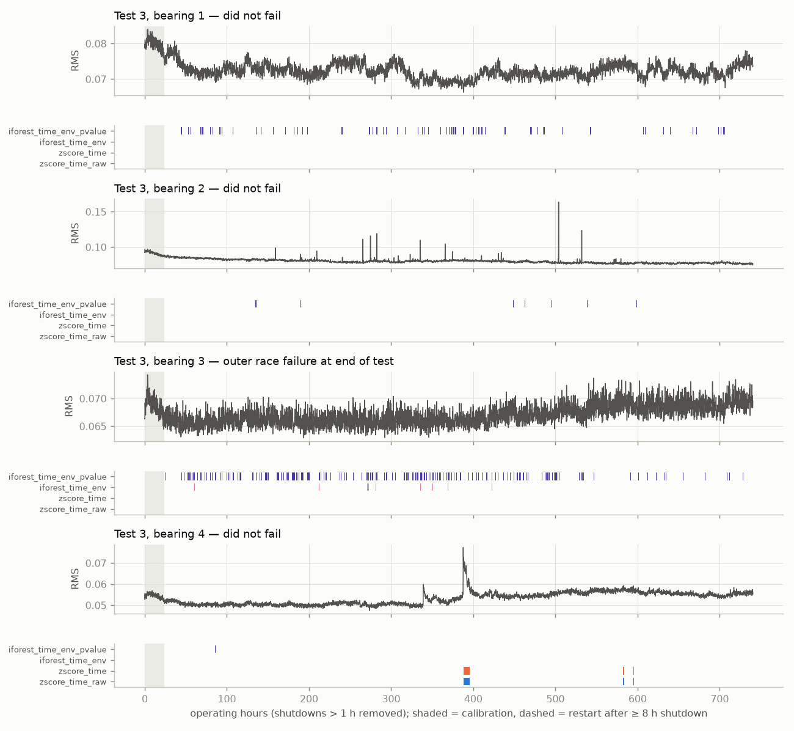
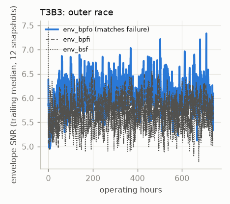
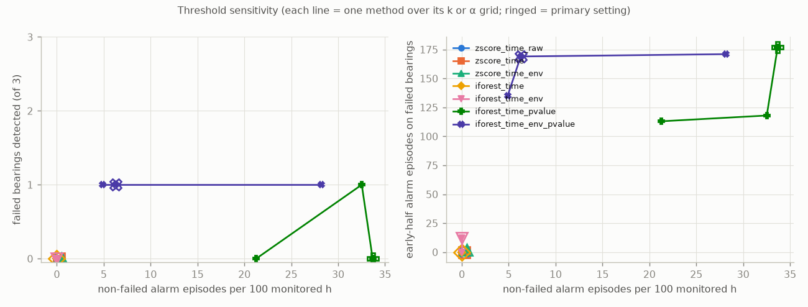
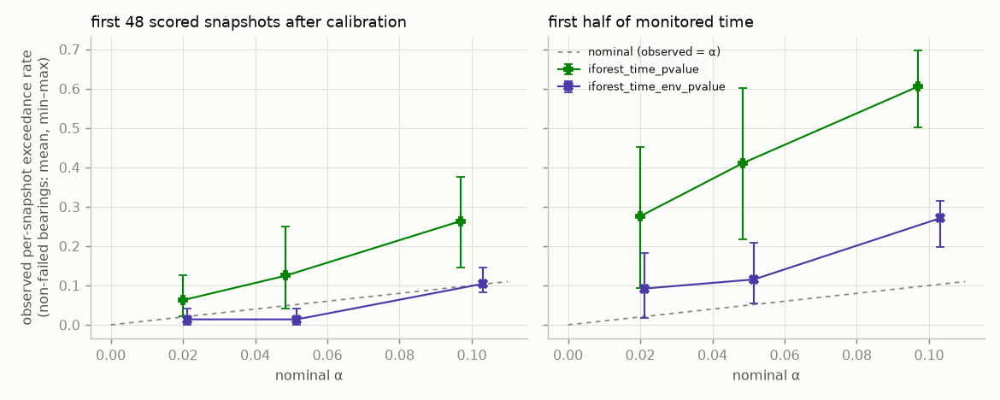

# Results: `holdout_v1_documented`

Generated by `python -m bearingguard.reporting.report`. Do not edit by hand.

Run commit `9e61758` (tree clean: True), tests [3], sealed data allowed: True, runtime 95.47 s.

## Primary settings (k = 3, α = 0.05, Isolation Forest seed 0)

Lead times and early-half episodes are listed per failed bearing in the order T3B3.

| method | failed detected | lead h | early-half eps (failed) | non-failed alarmed | non-failed eps / 100 h | non-failed time in alarm | restart-triggered eps | blind |
|---|---|---|---|---|---|---|---|---|
| zscore_time_raw | 0/1 | - | 0 | 1/3 | 0.23 | 0.5% | 0 | 0.0% |
| zscore_time | 0/1 | - | 0 | 1/3 | 0.23 | 0.5% | 0 | 0.0% |
| zscore_time_env | 0/1 | 390 | 2 | 2/3 | 0.51 | 0.6% | 0 | 0.0% |
| iforest_time | 0/1 | - | 0 | 0/3 | 0.00 | 0.0% | 0 | 0.0% |
| iforest_time_env | 0/1 | 680 | 12 | 0/3 | 0.00 | 0.0% | 0 | 0.0% |
| iforest_time_pvalue | 0/1 | 715 | 177 | 3/3 | 33.68 | 29.9% | 0 | 0.0% |
| iforest_time_env_pvalue | 1/1 | 715 | 169 | 3/3 | 6.28 | 2.7% | 0 | 0.0% |

## Per bearing (primary settings)

Failed bearings: D = detected (in alarm within the final window) or -, first-alarm lead time, episodes, time in alarm. Non-failed: episodes, time in alarm.

| bearing | zscore_time_raw | zscore_time | zscore_time_env | iforest_time | iforest_time_env | iforest_time_pvalue | iforest_time_env_pvalue |
|---|---|---|---|---|---|---|---|
| T3B1 | 0 eps / 0% | 0 eps / 0% | 1 eps / 0% | 0 eps / 0% | 0 eps / 0% | 335 eps / 38% | 122 eps / 7% |
| T3B2 | 0 eps / 0% | 0 eps / 0% | 0 eps / 0% | 0 eps / 0% | 0 eps / 0% | 212 eps / 16% | 12 eps / 1% |
| T3B3 (failed) | - -h / 0 eps / 0% | - -h / 0 eps / 0% | - 390h / 6 eps / 0% | - -h / 0 eps / 0% | - 680h / 13 eps / 1% | - 715h / 247 eps / 29% | D 715h / 246 eps / 19% |
| T3B4 | 5 eps / 2% | 5 eps / 2% | 10 eps / 2% | 0 eps / 0% | 0 eps / 0% | 177 eps / 36% | 1 eps / 0% |

## Threshold sensitivity (primary seed)

| method | setting | failed detected | lead h | early-half eps (failed) | non-failed alarmed | non-failed eps / 100 h | non-failed time in alarm | restart-triggered eps | blind |
|---|---|---|---|---|---|---|---|---|---|
| zscore_time_raw | k=3 | 0/1 | - | 0 | 1/3 | 0.23 | 0.5% | 0 | 0.0% |
| zscore_time_raw | k=4 | 0/1 | - | 0 | 1/3 | 0.05 | 0.3% | 0 | 0.0% |
| zscore_time_raw | k=5 | 0/1 | - | 0 | 1/3 | 0.09 | 0.3% | 0 | 0.0% |
| zscore_time_raw | k=6 | 0/1 | - | 0 | 1/3 | 0.09 | 0.3% | 0 | 0.0% |
| zscore_time | k=3 | 0/1 | - | 0 | 1/3 | 0.23 | 0.5% | 0 | 0.0% |
| zscore_time | k=4 | 0/1 | - | 0 | 1/3 | 0.05 | 0.3% | 0 | 0.0% |
| zscore_time | k=5 | 0/1 | - | 0 | 1/3 | 0.09 | 0.3% | 0 | 0.0% |
| zscore_time | k=6 | 0/1 | - | 0 | 1/3 | 0.09 | 0.3% | 0 | 0.0% |
| zscore_time_env | k=3 | 0/1 | 390 | 2 | 2/3 | 0.51 | 0.6% | 0 | 0.0% |
| zscore_time_env | k=4 | 0/1 | - | 0 | 1/3 | 0.05 | 0.3% | 0 | 0.0% |
| zscore_time_env | k=5 | 0/1 | - | 0 | 1/3 | 0.09 | 0.3% | 0 | 0.0% |
| zscore_time_env | k=6 | 0/1 | - | 0 | 1/3 | 0.09 | 0.3% | 0 | 0.0% |
| iforest_time | k=3 | 0/1 | - | 0 | 0/3 | 0.00 | 0.0% | 0 | 0.0% |
| iforest_time | k=4 | 0/1 | - | 0 | 0/3 | 0.00 | 0.0% | 0 | 0.0% |
| iforest_time | k=5 | 0/1 | - | 0 | 0/3 | 0.00 | 0.0% | 0 | 0.0% |
| iforest_time | k=6 | 0/1 | - | 0 | 0/3 | 0.00 | 0.0% | 0 | 0.0% |
| iforest_time_env | k=3 | 0/1 | 680 | 12 | 0/3 | 0.00 | 0.0% | 0 | 0.0% |
| iforest_time_env | k=4 | 0/1 | - | 0 | 0/3 | 0.00 | 0.0% | 0 | 0.0% |
| iforest_time_env | k=5 | 0/1 | - | 0 | 0/3 | 0.00 | 0.0% | 0 | 0.0% |
| iforest_time_env | k=6 | 0/1 | - | 0 | 0/3 | 0.00 | 0.0% | 0 | 0.0% |
| iforest_time_pvalue | alpha=0.1 | 1/1 | 715 | 118 | 3/3 | 32.52 | 60.0% | 0 | 0.0% |
| iforest_time_pvalue | alpha=0.05 | 0/1 | 715 | 177 | 3/3 | 33.68 | 29.9% | 0 | 0.0% |
| iforest_time_pvalue | alpha=0.0205 | 0/1 | 703 | 113 | 3/3 | 21.26 | 14.6% | 0 | 0.0% |
| iforest_time_env_pvalue | alpha=0.1 | 1/1 | 715 | 171 | 3/3 | 28.19 | 16.1% | 0 | 0.0% |
| iforest_time_env_pvalue | alpha=0.05 | 1/1 | 715 | 169 | 3/3 | 6.28 | 2.7% | 0 | 0.0% |
| iforest_time_env_pvalue | alpha=0.0205 | 1/1 | 705 | 135 | 2/3 | 4.89 | 1.9% | 0 | 0.0% |

## Isolation Forest seed variation (5 seeds, primary threshold)

| method | seeds | failed detected (min-max) | early-half eps on failed (min-max) | non-failed eps / 100 h (min-max) | non-failed time in alarm (min-max) |
|---|---|---|---|---|---|
| iforest_time | 5 | 0-0 | 0-0 | 0.00-0.00 | 0.0-0.0% |
| iforest_time_env | 5 | 0-0 | 4-12 | 0.00-0.05 | 0.0-0.0% |
| iforest_time_pvalue | 5 | 0-1 | 177-190 | 30.85-36.62 | 29.4-33.9% |
| iforest_time_env_pvalue | 5 | 0-1 | 134-186 | 4.61-12.93 | 1.6-7.4% |

## Calibration p-value: observed vs nominal exceedance (non-failed bearings, primary seed)

| method | alpha | near calibration, mean (max) | early half, mean (max) | whole run, mean (max) |
|---|---|---|---|---|
| iforest_time_pvalue | 0.1 | 0.264 (0.375) | 0.606 (0.698) | 0.550 (0.683) |
| iforest_time_pvalue | 0.05 | 0.125 (0.250) | 0.411 (0.602) | 0.353 (0.426) |
| iforest_time_pvalue | 0.0205 | 0.062 (0.125) | 0.275 (0.451) | 0.229 (0.296) |
| iforest_time_env_pvalue | 0.1 | 0.104 (0.146) | 0.271 (0.314) | 0.269 (0.357) |
| iforest_time_env_pvalue | 0.05 | 0.014 (0.042) | 0.115 (0.208) | 0.115 (0.203) |
| iforest_time_env_pvalue | 0.0205 | 0.014 (0.042) | 0.092 (0.183) | 0.094 (0.176) |

## Figures

