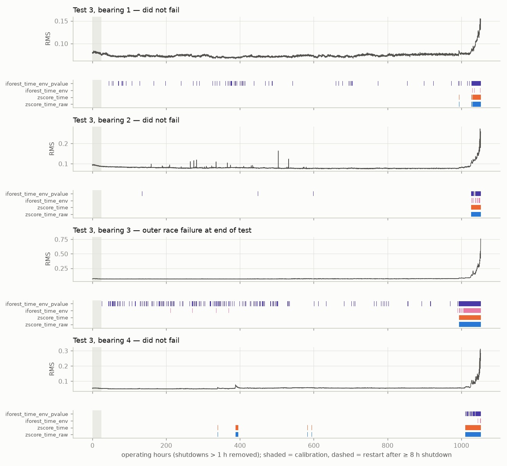
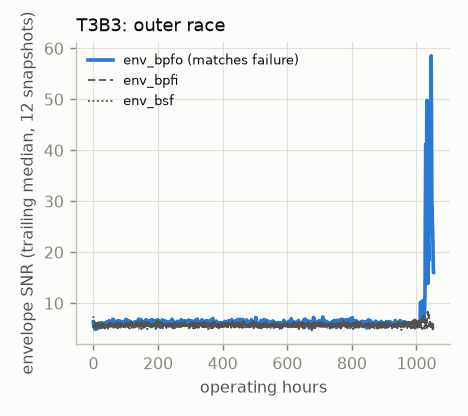
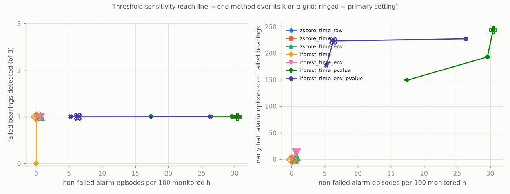
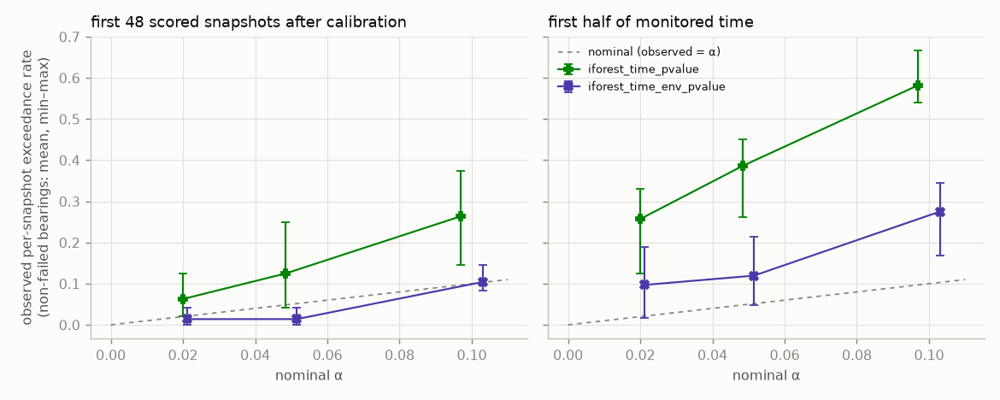

# Results: `holdout_v1_full_archive`

Generated by `python -m bearingguard.reporting.report`. Do not edit by hand.

Run commit `9e61758` (tree clean: False), tests [3], sealed data allowed: True, runtime 58.69 s.

## Primary settings (k = 3, α = 0.05, Isolation Forest seed 0)

Lead times and early-half episodes are listed per failed bearing in the order T3B3.

| method | failed detected | lead h | early-half eps (failed) | non-failed alarmed | non-failed eps / 100 h | non-failed time in alarm | restart-triggered eps | blind |
|---|---|---|---|---|---|---|---|---|
| zscore_time_raw | 1/1 | 59 | 0 | 3/3 | 0.39 | 3.4% | 0 | 0.0% |
| zscore_time | 1/1 | 59 | 0 | 3/3 | 0.39 | 3.4% | 0 | 0.0% |
| zscore_time_env | 1/1 | 702 | 4 | 3/3 | 0.68 | 3.5% | 0 | 0.0% |
| iforest_time | 1/1 | 58 | 0 | 0/3 | 0.00 | 0.0% | 0 | 0.0% |
| iforest_time_env | 1/1 | 992 | 13 | 3/3 | 0.68 | 0.5% | 0 | 0.0% |
| iforest_time_pvalue | 1/1 | 1027 | 244 | 3/3 | 30.43 | 26.1% | 0 | 0.0% |
| iforest_time_env_pvalue | 1/1 | 1027 | 223 | 3/3 | 6.29 | 5.0% | 0 | 0.0% |

## Per bearing (primary settings)

Failed bearings: D = detected (in alarm within the final window) or -, first-alarm lead time, episodes, time in alarm. Non-failed: episodes, time in alarm.

| bearing | zscore_time_raw | zscore_time | zscore_time_env | iforest_time | iforest_time_env | iforest_time_pvalue | iforest_time_env_pvalue |
|---|---|---|---|---|---|---|---|
| T3B1 | 4 eps / 2% | 4 eps / 2% | 5 eps / 3% | 0 eps / 0% | 5 eps / 0% | 418 eps / 34% | 159 eps / 9% |
| T3B2 | 1 eps / 3% | 1 eps / 3% | 2 eps / 3% | 0 eps / 0% | 12 eps / 1% | 323 eps / 17% | 23 eps / 3% |
| T3B3 (failed) | D 59h / 1 eps / 6% | D 59h / 1 eps / 6% | D 702h / 10 eps / 6% | D 58h / 18 eps / 2% | D 992h / 26 eps / 6% | D 1027h / 251 eps / 26% | D 1027h / 280 eps / 21% |
| T3B4 | 7 eps / 5% | 7 eps / 5% | 14 eps / 5% | 0 eps / 0% | 4 eps / 0% | 198 eps / 27% | 12 eps / 3% |

## Threshold sensitivity (primary seed)

| method | setting | failed detected | lead h | early-half eps (failed) | non-failed alarmed | non-failed eps / 100 h | non-failed time in alarm | restart-triggered eps | blind |
|---|---|---|---|---|---|---|---|---|---|
| zscore_time_raw | k=3 | 1/1 | 59 | 0 | 3/3 | 0.39 | 3.4% | 0 | 0.0% |
| zscore_time_raw | k=4 | 1/1 | 59 | 0 | 3/3 | 0.29 | 3.1% | 0 | 0.0% |
| zscore_time_raw | k=5 | 1/1 | 59 | 0 | 3/3 | 0.29 | 2.9% | 0 | 0.0% |
| zscore_time_raw | k=6 | 1/1 | 59 | 0 | 3/3 | 0.26 | 2.7% | 0 | 0.0% |
| zscore_time | k=3 | 1/1 | 59 | 0 | 3/3 | 0.39 | 3.4% | 0 | 0.0% |
| zscore_time | k=4 | 1/1 | 59 | 0 | 3/3 | 0.29 | 3.1% | 0 | 0.0% |
| zscore_time | k=5 | 1/1 | 59 | 0 | 3/3 | 0.29 | 2.9% | 0 | 0.0% |
| zscore_time | k=6 | 1/1 | 59 | 0 | 3/3 | 0.26 | 2.7% | 0 | 0.0% |
| zscore_time_env | k=3 | 1/1 | 702 | 4 | 3/3 | 0.68 | 3.5% | 0 | 0.0% |
| zscore_time_env | k=4 | 1/1 | 59 | 0 | 3/3 | 0.29 | 3.2% | 0 | 0.0% |
| zscore_time_env | k=5 | 1/1 | 59 | 0 | 3/3 | 0.36 | 3.0% | 0 | 0.0% |
| zscore_time_env | k=6 | 1/1 | 59 | 0 | 3/3 | 0.26 | 2.8% | 0 | 0.0% |
| iforest_time | k=3 | 1/1 | 58 | 0 | 0/3 | 0.00 | 0.0% | 0 | 0.0% |
| iforest_time | k=4 | 1/1 | 3 | 0 | 0/3 | 0.00 | 0.0% | 0 | 0.0% |
| iforest_time | k=5 | 0/1 | - | 0 | 0/3 | 0.00 | 0.0% | 0 | 0.0% |
| iforest_time | k=6 | 0/1 | - | 0 | 0/3 | 0.00 | 0.0% | 0 | 0.0% |
| iforest_time_env | k=3 | 1/1 | 992 | 13 | 3/3 | 0.68 | 0.5% | 0 | 0.0% |
| iforest_time_env | k=4 | 1/1 | 41 | 0 | 0/3 | 0.00 | 0.0% | 0 | 0.0% |
| iforest_time_env | k=5 | 1/1 | 25 | 0 | 0/3 | 0.00 | 0.0% | 0 | 0.0% |
| iforest_time_env | k=6 | 1/1 | 2 | 0 | 0/3 | 0.00 | 0.0% | 0 | 0.0% |
| iforest_time_pvalue | alpha=0.1 | 1/1 | 1027 | 193 | 3/3 | 29.59 | 55.0% | 0 | 0.0% |
| iforest_time_pvalue | alpha=0.05 | 1/1 | 1027 | 244 | 3/3 | 30.43 | 26.1% | 0 | 0.0% |
| iforest_time_pvalue | alpha=0.0205 | 1/1 | 1015 | 149 | 3/3 | 17.40 | 12.6% | 0 | 0.0% |
| iforest_time_env_pvalue | alpha=0.1 | 1/1 | 1027 | 227 | 3/3 | 26.35 | 18.1% | 0 | 0.0% |
| iforest_time_env_pvalue | alpha=0.05 | 1/1 | 1027 | 223 | 3/3 | 6.29 | 5.0% | 0 | 0.0% |
| iforest_time_env_pvalue | alpha=0.0205 | 1/1 | 1017 | 177 | 3/3 | 5.25 | 3.8% | 0 | 0.0% |

## Isolation Forest seed variation (5 seeds, primary threshold)

| method | seeds | failed detected (min-max) | early-half eps on failed (min-max) | non-failed eps / 100 h (min-max) | non-failed time in alarm (min-max) |
|---|---|---|---|---|---|
| iforest_time | 5 | 1-1 | 0-0 | 0.00-0.00 | 0.0-0.0% |
| iforest_time_env | 5 | 1-1 | 4-13 | 0.13-1.07 | 0.0-1.3% |
| iforest_time_pvalue | 5 | 1-1 | 230-261 | 27.80-33.15 | 26.1-29.7% |
| iforest_time_env_pvalue | 5 | 1-1 | 179-256 | 4.47-12.77 | 4.4-9.3% |

## Calibration p-value: observed vs nominal exceedance (non-failed bearings, primary seed)

| method | alpha | near calibration, mean (max) | early half, mean (max) | whole run, mean (max) |
|---|---|---|---|---|
| iforest_time_pvalue | 0.1 | 0.264 (0.375) | 0.582 (0.667) | 0.511 (0.695) |
| iforest_time_pvalue | 0.05 | 0.125 (0.250) | 0.387 (0.450) | 0.324 (0.401) |
| iforest_time_pvalue | 0.0205 | 0.062 (0.125) | 0.257 (0.330) | 0.208 (0.279) |
| iforest_time_env_pvalue | 0.1 | 0.104 (0.146) | 0.275 (0.345) | 0.280 (0.376) |
| iforest_time_env_pvalue | 0.05 | 0.014 (0.042) | 0.120 (0.215) | 0.132 (0.215) |
| iforest_time_env_pvalue | 0.0205 | 0.014 (0.042) | 0.097 (0.188) | 0.110 (0.189) |

## Figures

