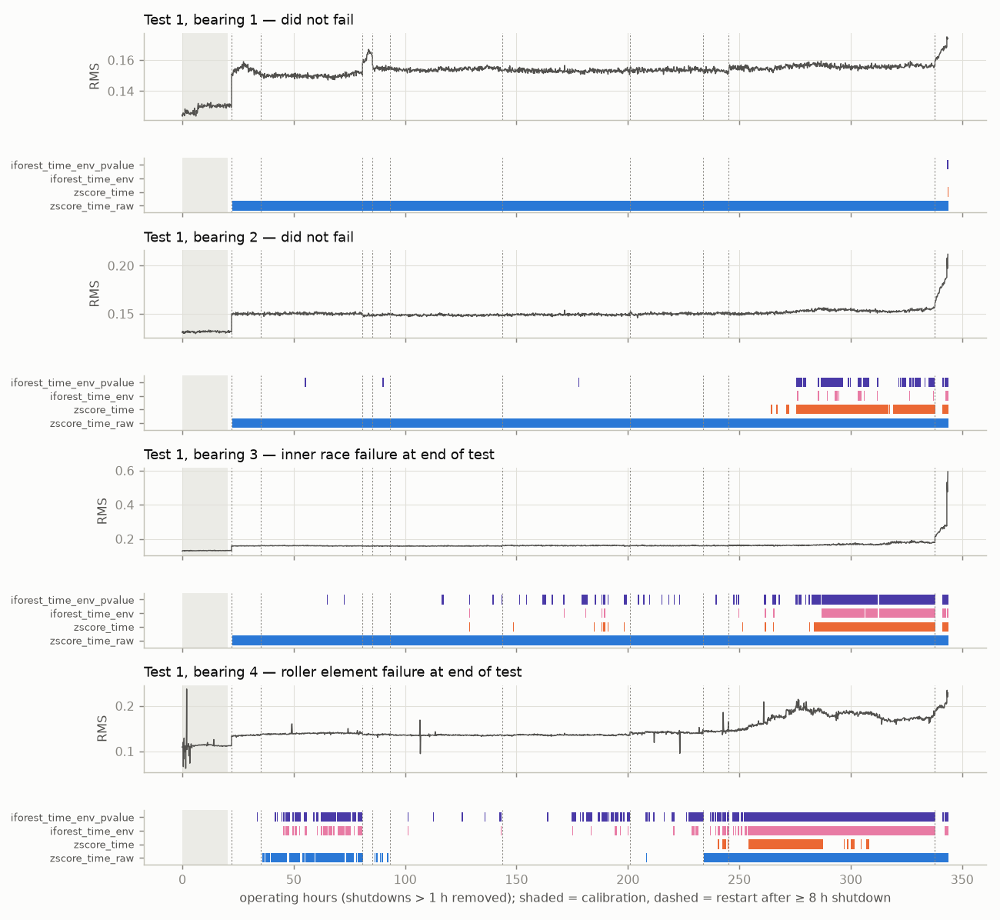
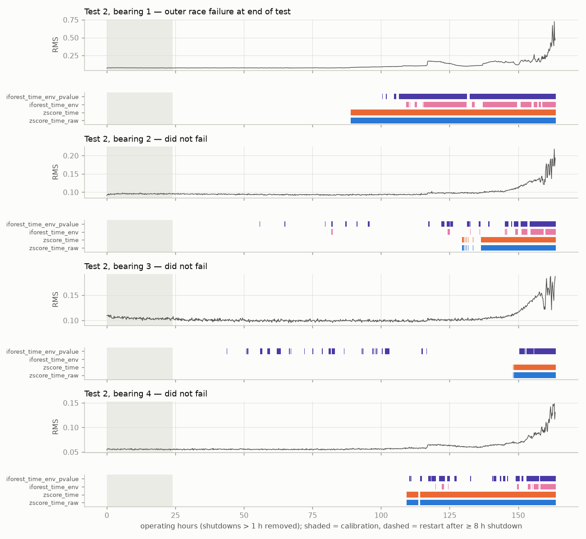
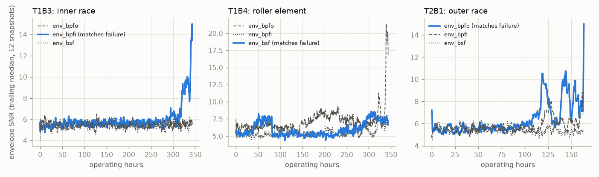
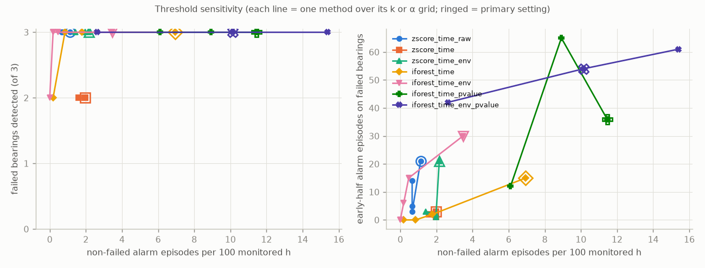
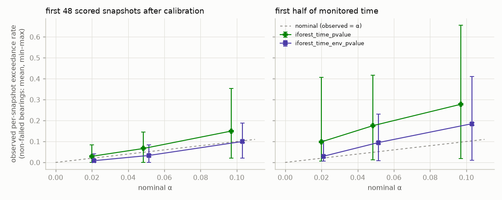

# Results: `protocol_v1_dev`

Generated by `python -m bearingguard.reporting.report`. Do not edit by hand.

Run commit `467543d` (tree clean: True), tests [1, 2], sealed data allowed: False, runtime 171.35 s.

## Primary settings (k = 3, α = 0.05, Isolation Forest seed 0)

Lead times and early-half episodes are listed per failed bearing in the order T1B3 / T1B4 / T2B1.

| method | failed detected | lead h | early-half eps (failed) | non-failed alarmed | non-failed eps / 100 h | non-failed time in alarm | restart-triggered eps | blind |
|---|---|---|---|---|---|---|---|---|
| zscore_time_raw | 3/3 | 321 / 308 / 74 | 1 / 19 / 1 | 5/5 | 1.13 | 53.7% | 14 | 0.0% |
| zscore_time | 2/3 | 215 / 103 / 74 | 2 / 0 / 1 | 5/5 | 1.97 | 18.0% | 4 | 4.5% |
| zscore_time_env | 3/3 | 227 / 297 / 74 | 3 / 17 / 1 | 5/5 | 2.16 | 18.2% | 9 | 4.5% |
| iforest_time | 3/3 | 227 / 278 / 55 | 11 / 4 / 0 | 4/5 | 6.95 | 13.2% | 8 | 4.5% |
| iforest_time_env | 3/3 | 215 / 298 / 54 | 3 / 27 / 0 | 3/5 | 3.47 | 3.9% | 13 | 4.5% |
| iforest_time_pvalue | 3/3 | 288 / 278 / 74 | 26 / 9 / 1 | 4/5 | 11.45 | 26.2% | 13 | 4.5% |
| iforest_time_env_pvalue | 3/3 | 279 / 310 / 63 | 21 / 33 / 0 | 5/5 | 10.14 | 12.3% | 19 | 4.5% |

## Per bearing (primary settings)

Failed bearings: D = detected (in alarm within the final window) or -, first-alarm lead time, episodes, time in alarm. Non-failed: episodes, time in alarm.

| bearing | zscore_time_raw | zscore_time | zscore_time_env | iforest_time | iforest_time_env | iforest_time_pvalue | iforest_time_env_pvalue |
|---|---|---|---|---|---|---|---|
| T1B1 | 1 eps / 99% | 1 eps / 0% | 1 eps / 0% | 0 eps / 0% | 0 eps / 0% | 0 eps / 0% | 2 eps / 0% |
| T1B2 | 1 eps / 99% | 10 eps / 20% | 12 eps / 20% | 4 eps / 0% | 18 eps / 2% | 33 eps / 5% | 40 eps / 10% |
| T1B3 (failed) | D 321h / 1 eps / 99% | D 215h / 21 eps / 19% | D 227h / 27 eps / 20% | D 227h / 37 eps / 20% | D 215h / 19 eps / 17% | D 288h / 62 eps / 28% | D 279h / 60 eps / 25% |
| T1B4 (failed) | D 308h / 23 eps / 49% | - 103h / 11 eps / 12% | D 297h / 53 eps / 24% | D 278h / 16 eps / 33% | D 298h / 53 eps / 37% | D 278h / 23 eps / 35% | D 310h / 69 eps / 50% |
| T2B1 (failed) | D 74h / 1 eps / 53% | D 74h / 1 eps / 53% | D 74h / 1 eps / 53% | D 55h / 6 eps / 37% | D 54h / 11 eps / 30% | D 74h / 6 eps / 41% | D 63h / 5 eps / 41% |
| T2B2 | 6 eps / 20% | 6 eps / 20% | 6 eps / 21% | 33 eps / 37% | 10 eps / 10% | 31 eps / 61% | 20 eps / 17% |
| T2B3 | 2 eps / 11% | 2 eps / 11% | 2 eps / 11% | 7 eps / 8% | 0 eps / 0% | 35 eps / 35% | 28 eps / 17% |
| T2B4 | 2 eps / 39% | 2 eps / 39% | 2 eps / 39% | 30 eps / 21% | 9 eps / 7% | 23 eps / 29% | 18 eps / 17% |

## Threshold sensitivity (primary seed)

| method | setting | failed detected | lead h | early-half eps (failed) | non-failed alarmed | non-failed eps / 100 h | non-failed time in alarm | restart-triggered eps | blind |
|---|---|---|---|---|---|---|---|---|---|
| zscore_time_raw | k=3 | 3/3 | 321 / 308 / 74 | 1 / 19 / 1 | 5/5 | 1.13 | 53.7% | 14 | 0.0% |
| zscore_time_raw | k=4 | 3/3 | 321 / 306 / 74 | 1 / 12 / 1 | 5/5 | 0.66 | 52.4% | 10 | 0.0% |
| zscore_time_raw | k=5 | 3/3 | 321 / 282 / 74 | 1 / 3 / 1 | 5/5 | 0.66 | 51.8% | 9 | 0.0% |
| zscore_time_raw | k=6 | 3/3 | 321 / 277 / 72 | 1 / 1 / 1 | 5/5 | 0.66 | 51.2% | 9 | 0.0% |
| zscore_time | k=3 | 2/3 | 215 / 103 / 74 | 2 / 0 / 1 | 5/5 | 1.97 | 18.0% | 4 | 4.5% |
| zscore_time | k=4 | 2/3 | 215 / 103 / 74 | 1 / 0 / 1 | 5/5 | 1.60 | 15.9% | 3 | 4.5% |
| zscore_time | k=5 | 2/3 | 215 / 101 / 74 | 1 / 0 / 1 | 4/5 | 1.97 | 14.4% | 2 | 4.5% |
| zscore_time | k=6 | 2/3 | 57 / 101 / 72 | 0 / 0 / 1 | 4/5 | 1.97 | 13.0% | 2 | 4.5% |
| zscore_time_env | k=3 | 3/3 | 227 / 297 / 74 | 3 / 17 / 1 | 5/5 | 2.16 | 18.2% | 9 | 4.5% |
| zscore_time_env | k=4 | 3/3 | 215 / 293 / 74 | 1 / 1 / 1 | 5/5 | 1.41 | 16.0% | 3 | 4.5% |
| zscore_time_env | k=5 | 3/3 | 215 / 151 / 74 | 1 / 0 / 1 | 4/5 | 1.97 | 14.4% | 2 | 4.5% |
| zscore_time_env | k=6 | 3/3 | 57 / 101 / 72 | 0 / 0 / 1 | 4/5 | 1.97 | 13.0% | 2 | 4.5% |
| iforest_time | k=3 | 3/3 | 227 / 278 / 55 | 11 / 4 / 0 | 4/5 | 6.95 | 13.2% | 8 | 4.5% |
| iforest_time | k=4 | 3/3 | 215 / 115 / 47 | 2 / 0 / 0 | 2/5 | 1.78 | 4.3% | 9 | 4.5% |
| iforest_time | k=5 | 3/3 | 56 / 112 / 12 | 0 / 0 / 0 | 2/5 | 0.84 | 1.8% | 7 | 4.5% |
| iforest_time | k=6 | 2/3 | - / 107 / 1 | 0 / 0 / 0 | 2/5 | 0.19 | 0.2% | 5 | 4.5% |
| iforest_time_env | k=3 | 3/3 | 215 / 298 / 54 | 3 / 27 / 0 | 3/5 | 3.47 | 3.9% | 13 | 4.5% |
| iforest_time_env | k=4 | 3/3 | 57 / 298 / 46 | 0 / 15 / 0 | 3/5 | 0.47 | 0.6% | 9 | 4.5% |
| iforest_time_env | k=5 | 3/3 | 56 / 293 / 46 | 0 / 6 / 0 | 2/5 | 0.19 | 0.1% | 3 | 4.5% |
| iforest_time_env | k=6 | 2/3 | 55 / 101 / - | 0 / 0 / 0 | 0/5 | 0.00 | 0.0% | 0 | 4.5% |
| iforest_time_pvalue | alpha=0.1 | 3/3 | 316 / 281 / 74 | 48 / 16 / 1 | 4/5 | 8.92 | 39.2% | 18 | 4.5% |
| iforest_time_pvalue | alpha=0.05 | 3/3 | 288 / 278 / 74 | 26 / 9 / 1 | 4/5 | 11.45 | 26.2% | 13 | 4.5% |
| iforest_time_pvalue | alpha=0.0205 | 3/3 | 227 / 277 / 55 | 11 / 1 / 0 | 4/5 | 6.10 | 17.2% | 10 | 4.5% |
| iforest_time_env_pvalue | alpha=0.1 | 3/3 | 279 / 312 / 134 | 24 / 36 / 1 | 5/5 | 15.40 | 23.7% | 21 | 4.5% |
| iforest_time_env_pvalue | alpha=0.05 | 3/3 | 279 / 310 / 63 | 21 / 33 / 0 | 5/5 | 10.14 | 12.3% | 19 | 4.5% |
| iforest_time_env_pvalue | alpha=0.0205 | 3/3 | 279 / 298 / 54 | 20 / 22 / 0 | 4/5 | 2.63 | 4.3% | 15 | 4.5% |

## Isolation Forest seed variation (5 seeds, primary threshold)

| method | seeds | failed detected (min-max) | early-half eps on failed (min-max) | non-failed eps / 100 h (min-max) | non-failed time in alarm (min-max) |
|---|---|---|---|---|---|
| iforest_time | 5 | 3-3 | 10-20 | 5.91-7.32 | 10.7-14.0% |
| iforest_time_env | 5 | 3-3 | 25-30 | 2.44-3.57 | 2.1-3.9% |
| iforest_time_pvalue | 5 | 3-3 | 22-43 | 8.73-12.49 | 24.2-26.2% |
| iforest_time_env_pvalue | 5 | 3-3 | 45-54 | 7.42-10.89 | 9.3-12.3% |

## Calibration p-value: observed vs nominal exceedance (non-failed bearings, primary seed)

| method | alpha | near calibration, mean (max) | early half, mean (max) | whole run, mean (max) |
|---|---|---|---|---|
| iforest_time_pvalue | 0.1 | 0.150 (0.354) | 0.278 (0.656) | 0.417 (0.621) |
| iforest_time_pvalue | 0.05 | 0.067 (0.146) | 0.176 (0.418) | 0.285 (0.604) |
| iforest_time_pvalue | 0.0205 | 0.029 (0.083) | 0.098 (0.406) | 0.189 (0.589) |
| iforest_time_env_pvalue | 0.1 | 0.100 (0.188) | 0.185 (0.411) | 0.289 (0.414) |
| iforest_time_env_pvalue | 0.05 | 0.033 (0.083) | 0.095 (0.232) | 0.179 (0.258) |
| iforest_time_env_pvalue | 0.0205 | 0.008 (0.042) | 0.029 (0.105) | 0.078 (0.191) |

## Figures

